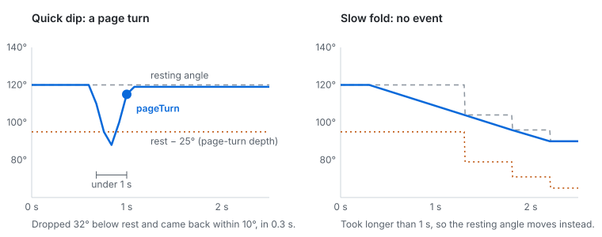

# 翻页手势的原理

[English](how-it-works.md) | 简体中文

iOS 27.1 会把 iPhone Duo 的铰链报告成一个状态（合上、半开、全开）和一个 0° 到 180° 的角度。HingeKit 把这串数据变成 app 真正关心的三样东西：**姿态**、**打开 / 合上**事件，以及**翻页**。

这些都可以在[在线演示](https://midjug3nine.github.io/HingeKit/)里直接试。



## 1. 姿态，带滞后

`PostureClassifier` 把每个读数归成 `closed`、`halfOpen` 或 `flat`：

| 角度 | 姿态 |
| --- | --- |
| 状态是合上，或角度 ≤ 8° | `closed` |
| 中间 | `halfOpen` |
| ≥ 165° | `flat` |

如果铰链正好停在 165° 附近，姿态会在 `halfOpen` 和 `flat` 之间来回跳。为了避免这种情况，离开一个姿态要多走 10°：摊平的设备要降到 155° 以下才算半开，合上的设备要超过 18° 才算打开。

## 2. 打开和合上

`FoldGestureRecognizer` 每次都拿新姿态和上一个比。从 `closed` 变成 `halfOpen` 或 `flat` 就是 `.opened`，反过来就是 `.closed`。每次变化也会报一个 `.postureChanged(from:to:)`。

就算系统只给状态、不给角度，这两个事件也照样能用。

## 3. 翻页

设备打开时，识别器会记住一个**静止角度**，也就是用户平时拿着的角度。

1. 角度变大时，静止角度马上跟上。角度往下飘一点点时，静止角度慢慢跟（每个读数跟 20%），小幅晃动就被吸收掉了。
2. 角度比静止角度低了 **8° 以上**，就开始算一次“往回折”，同时开始计时。
3. 往回折的最深处比静止角度低 **至少 25°**，而且又回到静止角度 **10° 以内**，就是一次 `.pageTurn`。
4. 如果 **1 秒内** 没完成，就不是轻折，而是用户在换角度。这次往回折作废，静止角度移到新的位置，所以慢慢折到新角度永远不会翻页。

合上设备会清空所有状态。打开时，第一个打开角度就是静止角度。

这五个数字都在 `FoldGestureRecognizer.Configuration` 里，可以调：

```swift
var config = FoldGestureRecognizer.Configuration()
config.pageTurnDepth = 30      // 度
config.pageTurnWindow = 0.8    // 秒
let recognizer = FoldGestureRecognizer(configuration: config)
```

## 为什么这样设计

- **纯值类型。** 没有计时器，不调用 `Date()`，没有系统调用。时间来自读数本身，所以同一份代码可以跑在真实铰链、模拟面板、网页演示和单元测试上。
- **有测试。** 上面每种情况（快速往回折、小幅晃动、慢慢折、折下去不回来、连续两次轻折、从摊平状态轻折、只有状态没有角度）在 [`Tests/HingeKitTests`](../Tests/HingeKitTests) 里都有对应的测试。
- **目前用模拟输入调参。** 默认值只是起点。如果在真机上感觉不对，欢迎开 issue 说说你是怎么试的。
